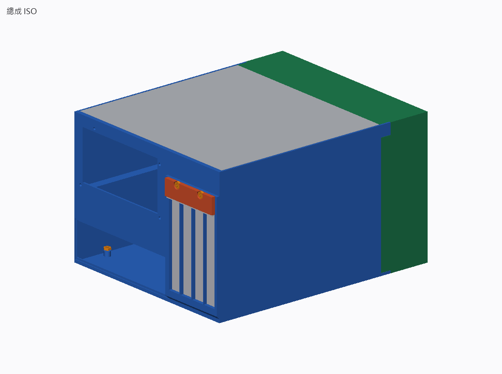
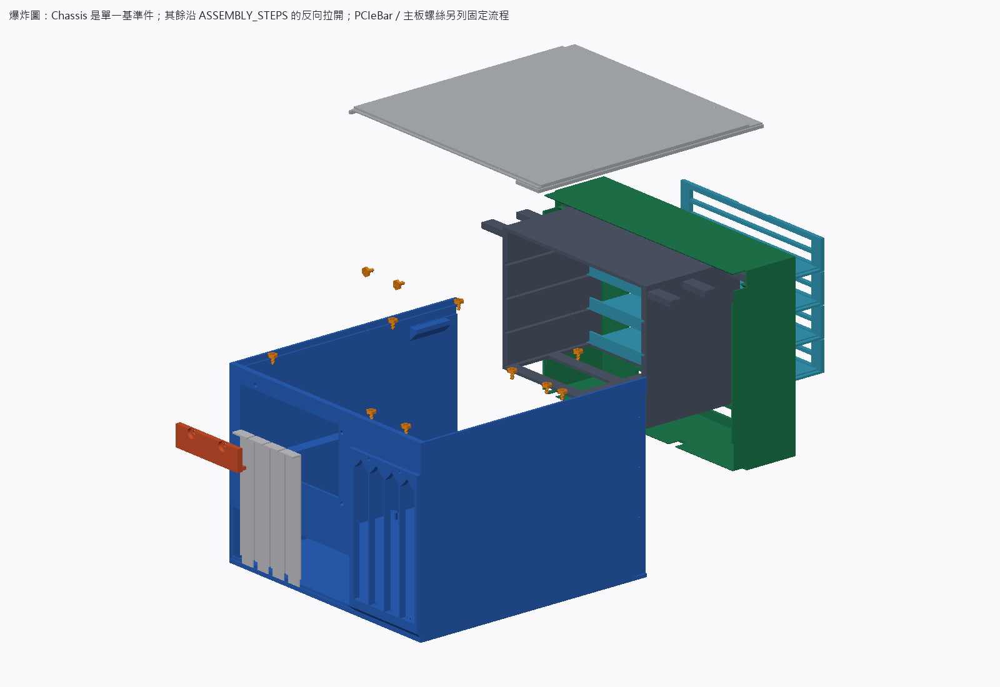

# 3DP-MATX — 全 3D 列印 microATX NAS 機殼

一台**沒有任何鈑金件**的 microATX NAS 機殼：外殼、碟架、托盤，連鎖主機板的螺絲
都是印出來的。整台只用到 20 顆標準 #6-32（電源 4、硬碟 16）。

幾何不是畫出來的，是**算出來的**——所有尺寸集中在 `腳本/參數.py`，機殼由 FreeCAD
Part 模組 CSG 布林生成，再由 `verify_case.py` 對規格書逐條驗證；本文與 `規格/`、`文件/`
底下的所有文件都只是那個檔的投影。

<p align="center">
  
  
</p>

## 規格

| | |
|---|---|
| 外形 | **252.68 × 302.61 × 180.12 mm**（單一長方體，無下裙、無外凸腳）**＝ 13.77 L** |
| 靠牆深度 | **311.61 mm**（含後牆補強與外置 `PCIeBar`；螺絲頭已沉頭） |
| 主機板 | microATX 244 × 244 **平躺**；9 個 Ø8 × 6.35 支撐肩盲內牙 + 印製 `MB_Screw` |
| 電源 | ATX PS/2 150 × 86 × 140，**在 I/O 擋板正上方、頂到內頂**，與主板同腔無隔板 |
| 硬碟 | **4 × 3.5"** 平躺四層，碟架置中，托盤自前方抽換，接頭側留 30 mm 走線區 |
| 擴充 | 全高 PCIe **×4**，卡長上限 **190.61 mm**（> CEM 半長卡 167.65） |
| 板上淨空 | Area A **76.20** = microATX Table 6 **required**（< recommended 88.90，見下） |
| 列印 | Bambu Lab A1（256³）／0.4 mm nozzle／PETG；**8 種 STL、共 24 件** |
| 用料 | 一件一份 1081.3 cm³；**含份數 1300.2 cm³ ≈ 1.66 kg**（買 2 捲） |

> **可以說**「板上淨空達 microATX required」。
> **不可以說**「完全相容 microATX」——recommended 88.90 未達，PCIe 卡長 190.61 也是取捨。

## 8 種列印件

| Key | STL | 數量 | 列印姿態 | Process preset |
|---|---|---:|---|---|
| `Chassis_Body` | `機殼本體_主板段一體式.stl` | 1 | Z+（地板貼床）／0° | `機殼件 0.16 支撐` |
| `Top_MB` | `頂蓋_主板段.stl` | 1 | Z−／0° | `機殼件 0.16 支撐` |
| `Front_Shroud` | `前罩_含進氣柵.stl` | 1 | Y−／0° | `機殼件 0.16 無支撐` |
| `HDD_Rack` | `碟架_四層導軌.stl` | 1 | Z−／**45°** | `機殼件 0.16 支撐` |
| `HDD_Tray` | `碟托盤.stl` | 4 | Z+／0° | `機殼件 0.16 支撐` |
| `PCIeBlank` | `PCIe槽蓋.stl` | 4 | Z+／0° | `機殼件 0.16 無支撐` |
| `PCIeBar` | `PCIe壓條_外置.stl` | 1 | Y+／0° | `機殼件 0.16 無支撐` |
| `MB_Screw` | `主板螺絲_印製.stl` | **11** | Z+（六角頭貼床）／0° | `主板螺絲 0.12`（100%、無支撐） |

姿態與 preset 的唯一來源是 `腳本/列印擺位.py::PRINT_PLAN`；支撐開關直接讀 preset 的
`enable_support`，不另外維護清單。三份 preset 在 `列印設定/`。

## 組裝

外殼五步，全部自 **+Y（前方）** 滑入，唯一來源 `參數.ASSEMBLY_STEPS`：

1. **Chassis_Body** — 地板、左右牆、後牆是同一個列印件，直接當基準。
2. **HDD_Rack** — 滑到 `RACK_STOP_Y` 盲端；重量落在左右牆的 8 mm 承托肩上。
3. **Top_MB** — 三面成槽（兩側舌 + 後緣下伸舌），末段越過 2 顆可 cam-out detent。
4. **Front_Shroud** — 14 mm 四面搭接、45° 導入面、10 顆 detent。
5. **HDD_Tray ×4** — 裝好碟後插入各層導軌；`Front_Shroud` 與 `HDD_Tray` 的 +Y 是
   **宣告過的**釋放方向，其餘 22 個方向都必須鎖住（六向保持力表逐項量）。

| 五金 | 數量 | 用途 |
|---|---:|---|
| #6-32 | 4 | ATX 電源後面板 |
| #6-32 × 1/4" | 16 | 每顆 HDD 4 顆，自托盤底鎖入 SFF-8301 底孔 |
| 印製 `MB_Screw` | 11 | 主板 9 + `PCIeBar` 2（同一種，夾持厚都是 1.57） |
| I/O shield、10 mm 瞬時按鈕 | 各 1 | 後牆開孔／前罩 Ø10.2 孔 |

逐步圖與卡榫剖面特寫見 `規格/組裝_*.png`，細節在 `文件/零件清單與組裝.md`。

## 印之前一定要知道的三件事

1. **A1 的床只剩 0.81 mm/邊。** Chassis 裸件 252.68 × 252.85，加普通支撐的代理
   footprint 是 254.22 × 254.39。必須 `no_brim`、brim 0、skirt 0、
   `raft_first_layer_expansion = 0`；**不能用 tree(auto)**（45° 分枝會脹到 605 × 600）。
   任何往 −Y 的新凸出都要先跑 `列印擺位.py --best` 才知道還放不放得下。
2. **支撐 preset 是「脫模導向」的，不要調回更緊。** `support_object_xy_distance 0.35`
   （＝ Bambu 原廠值，也是床能容忍的上限）、top/bottom z `0.32`（2 層）、
   接觸面 1 層、`snug`。PETG 的層間與側向黏著比 PLA 強，間隙調小就是把支撐焊上去。
3. **PCIe 那四個窗不應該生支撐。** 開孔頂是 45° 尖頂、窗框底緣是 45° 引入楔，
   幾何層已驗「開孔 x 帶內一片朝下面都沒有」。如果切片器還是在那裡放支撐，
   代表 preset 沒吃到（先看 `support_threshold_angle = 30`），**不要硬拆**——
   孔與孔之間只有 1.42 mm 的肋。

## 幾個非顯然的設計決定

- **主機殼是一件。** 地板、左右牆、後牆真實 fuse 成單一 `Chassis_Body`；
  第十一輪的四片式接合會彈，而牆厚 2.4 mm 塞不下任何像樣的榫。
- **電源在主板正上方，而且頂到內頂。** 靠的是 Area A 的規格淨空。電源被頂上去
  讓出來的 26.20 mm 全部變成板上散熱器空間——**機殼一點都沒有變高**。
- **碟架坐在承托肩上，不是吊在槽裡。** 8 mm 承重面 + 45° 自撐斜撐，承載面積
  43 → 576 mm²；側槽只保留 +Z 約束。
- **主板固定不穿出 PCB。** Ø8 支撐肩提供 6.35 板底淨空，肩內切 5.20 盲內牙，
  8 mm AF 印製六角螺絲由上方鎖入；頭頂另有直邊十字工具槽（開在貼床面 ⇒ 免支撐）。
- **I/O 深度用 Fig.4 的側視基準**（Datum B 後方 12.27），不是「板緣 − 隨手取的餘量」。
  舊式算法會讓連接器面戳進後牆 0.64 mm，主板推不到底。
- **支撐塔走的路，跟它要撐的是誰無關。** 扯斷 PCIe 三根肋的其實是頂鉤唇底面
  拉起來的 176 mm 支撐塔，它沿後牆內面爬過肋的內側——鉤唇前伸量因此 6.0 → 3.0。

## 重建與驗證

`FreeCADCmd` 收不到中文 argv，入口必須走 ASCII junction `scripts/`：

```powershell
FreeCADCmd -c <root>\scripts\_run_build.py     # BUILD_OK / 8 STL / 1081.3 / 1300.2 cm³
FreeCADCmd -c <root>\scripts\_run_verify.py    # RESULT: ALL CHECKS PASSED
FreeCADCmd -c <root>\scripts\_run_negtest.py   # NEGTEST 86/86 / NEGTEST_OK
python -m unittest 測試/test_參數.py            # 71 tests
python 腳本\列印擺位.py --best                 # Chassis 254.22 × 254.39（0.81 mm/邊）
python 腳本\驗切片設定.py                      # FAILURES = 0
python 腳本\渲染預覽.py                        # 規格/總成視圖_*.png
python 腳本\組裝圖.py                          # 爆炸／逐步 ×5／卡榫特寫 A–H
```

最後一步一律是 **FreeCAD GUI 開最新 `CAD/機殼總成.FCStd` 目視複檢**：探針只回答它
被寫出來要問的問題，歪掉、穿模、開錯邊這種事只有眼睛抓得到。

使用者在 Bambu Studio 切出真 G-code 之後，可逐檔跑
`python 腳本\驗切片gcode.py <明確的.gcode路徑>` 檢查擠出路徑是否超床。

## 驗證分層（誠實）

| 層 | 狀態 |
|---|---|
| 參數／manifest／preset 靜態設定 | ✅ 71 回歸測試 + `驗切片設定.py` |
| 幾何、硬體標稱包絡、裝配動作、六向保持力 | ✅ `ALL CHECKS PASSED` |
| 檢查本身不是空的 | ✅ `NEGTEST 86/86`（把修掉的病灶塞回去，對應檢查必須變紅） |
| FreeCAD GUI 目視 | ✅ 8 objects、逐件 1 Solid / valid / closed、四視角 |
| **Bambu Studio 真實切片／真 G-code** | ⏳ **由使用者驗證**；45° 面是否真的免支撐、加大的間隙好不好拆，只有這一層能證明 |
| 實印、試裝、EMI、螺牙壽命、熱 | ❌ **未驗證** |

`failures=0` 只代表腳本層通過。另外兩件事必須講清楚：**PSU 大面風扇朝下是使用者
指定的假設**（ATX12V 規格沒寫大面風扇在哪一面），**PCIe 卡長 190.61 是碟架置中後的
刻意取捨**。氣流只算過開口面積（前柵 15939 mm² > 120 mm 風扇 11310），
**風壓與溫升沒有量過**。

## 目錄

```text
腳本/          建模、驗證、出圖、列印計畫與 preset 檢查
  參數.py      ★ 尺寸、BOM、份數與組裝步驟的唯一真實來源
規格/          設計規格、孔位、規範清單、可用性裁決、預覽與組裝圖
文件/          零件清單與組裝、列印參數與擺位
列印件/        8 種 STL（由 build 重生）
列印設定/      Bambu Studio process preset ×3
CAD/           FreeCAD 總成檔
測試/          參數回歸測試（71 tests）
tasks/         規劃與歷輪教訓
CONTEXT.md     開發交接文件（接手先讀這個）
CLAUDE.md      專案硬規則（與 AGENTS.md 同內容）
```

環境：FreeCAD 1.2（`FreeCADCmd`）、Python 3.11+（`pymupdf`、`pillow`）、Bambu Studio 2.7+。

## 需自備的規格書

`參考/*.pdf` 不隨專案散布：microATX 1.2、ATX12V Design Guide、PCIe CEM r2.0、SFF-8301。
引用前先 `fitz.open()` 確認第一頁——曾經有一份 151 KB 的「PCIe CEM」其實是下載失敗頁，
撐著整組 PCIe 尺寸好幾輪。

## 授權

尚未指定。在補上 `LICENSE` 前，預設保留所有權利。
